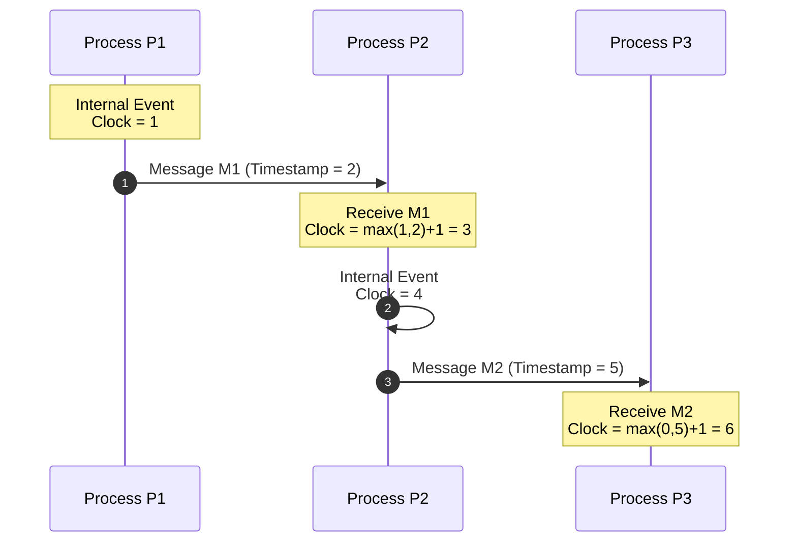

# Lamport Logical Clock Simulator

### An Interactive Simulation of Logical Clocks and Event Ordering in Distributed Systems


## 📌 Project Overview

The **Lamport Logical Clock Simulator** is a Distributed Computing project designed to demonstrate how logical clocks maintain the ordering of events across multiple distributed processes.

In a distributed system, different processes execute independently and do not necessarily share a synchronised physical clock. Lamport's Logical Clock algorithm provides a mechanism to assign logical timestamps to events and maintain their causal ordering.

This project simulates multiple distributed processes, internal events, message communication, and timestamp updates to demonstrate how event ordering is maintained.

## 🎯 Objectives

- Understand the concept of Lamport Logical Clocks.
- Simulate multiple independent distributed processes.
- Generate internal, send, and receive events.
- Implement logical timestamp update rules.
- Demonstrate message passing between processes.
- Visualize event ordering and causal relationships.

## 🏗️ System Architecture

The simulator consists of multiple distributed processes. Each process maintains its own logical clock and communicates with other processes through messages.

### Distributed Process Communication Diagram

The following diagram illustrates three distributed processes communicating with each other using Lamport timestamps.



**Diagram explanation:**

1. Process P1 performs an internal event and updates its clock to 1.
2. P1 sends a message to P2 with timestamp 2.
3. P2 receives the message and updates its clock to 3.
4. P2 performs another event and updates its clock to 4.
5. P2 sends a message to P3 with timestamp 5.
6. P3 receives the message and updates its clock to 6.

## ⚙️ Lamport Logical Clock Algorithm

The simulator implements three fundamental rules.

### Rule 1: Internal Event

Whenever a process performs an internal event, increment its logical clock by one.

**Formula:**

`C(i) = C(i) + 1`

### Rule 2: Sending a Message

Before sending a message, increment the sender's clock and attach the updated timestamp to the message.

**Formula:**

`C(i) = C(i) + 1`

### Rule 3: Receiving a Message

When a process receives a message, update its logical clock using the maximum of its current clock and the received timestamp, then increment by one.

**Formula:**

`C(j) = max(C(j), Tm) + 1`

Where:

- `C(i)` = Logical clock of process i.
- `C(j)` = Logical clock of receiving process j.
- `Tm` = Timestamp attached to the received message.

## 🚀 Key Features

- **Multiple Process Simulation:** Create and simulate multiple distributed processes.
- **Independent Logical Clocks:** Maintain separate timestamps for each process.
- **Internal Events:** Generate events within individual processes.
- **Message Passing:** Simulate communication between distributed processes.
- **Automatic Timestamp Updates:** Apply Lamport's logical clock algorithm.
- **Event Ordering:** Display events according to their logical timestamps.
- **Causal Relationship:** Demonstrate the happens-before relationship.
- **Execution History:** Maintain a record of generated events and messages.
- **Timeline Visualization:** Represent process execution and communication graphically.

## 🛠️ Technologies Used

| Technology   | Purpose                                      |
| ------------ | -------------------------------------------- |
| Java         | Core simulation and algorithm implementation |
| HTML         | Dashboard structure                          |
| CSS          | User interface styling                       |
| JavaScript   | Interactive visualization                    |
| Git & GitHub | Version control and project hosting          |

## 📂 Project Structure

```text
lamport-logical-clock-simulator/
│
├── src/
│   ├── Main.java
│   ├── Process.java
│   ├── LamportClock.java
│   ├── Event.java
│   ├── Message.java
│   └── Simulator.java
│
├── frontend/
│   ├── index.html
│   ├── style.css
│   └── script.js
│
├── screenshots/
│
├── docs/
│   └── algorithm.md
│
├── README.md
└── LICENSE
```

## 📊 Sample Simulation

Consider three distributed processes: P1, P2, and P3.

| Process | Event                   | Logical Timestamp |
| ------- | ----------------------- | ----------------: |
| P1      | Internal Event          |                 1 |
| P1      | Send Message to P2      |                 2 |
| P2      | Internal Event          |                 1 |
| P2      | Receive Message from P1 |                 3 |
| P2      | Internal Event          |                 4 |
| P2      | Send Message to P3      |                 5 |
| P3      | Receive Message from P2 |                 6 |

### Expected Result

The simulator demonstrates that:

- Every event receives a logical timestamp.
- Message communication maintains causal ordering.
- Receiving processes update their clocks correctly.
- Events can be ordered using their logical timestamps.

**Note:** Equal timestamps can occur for concurrent events. Lamport clocks guarantee that if event A happens before event B, then timestamp(A) is less than timestamp(B). The reverse is not necessarily true.

## ▶️ How to Run

1. Clone the repository:

```bash
git clone https://github.com/keerthanatec26-tec/lamport-logical-clock-simulator.git
```

2. Navigate to the project directory:

```bash
cd lamport-logical-clock-simulator
```

3. Compile the Java program:

```bash
javac -d out src/*.java
```

4. Run the application:

```bash
java -cp out Main
```

*Note: These commands apply to the Java implementation. The web dashboard can be launched separately through its frontend entry point.*

## 📚 Learning Outcomes

- Understanding distributed system architecture.
- Implementing Lamport's Logical Clock algorithm.
- Understanding message communication between processes.
- Learning logical timestamp synchronization.
- Analyzing event ordering and causal relationships.
- Visualizing distributed system execution.

## 🔮 Future Enhancements

- Support for a larger number of distributed processes.
- Interactive real-time event execution.
- Step-by-step simulation controls.
- Custom message communication between processes.
- Comparison of Lamport clocks with Vector clocks.
- Improved timeline and event visualization.

## 👩‍💻 Author

**Keerthana R**

Computer Science and Engineering Student

GitHub: [@keerthanatec26-tec](https://github.com/keerthanatec26-tec)

## 📄 License

This project is licensed under the MIT License. See the [LICENSE](LICENSE) file for details.

---

⭐ If you find this project useful, consider giving it a star!

